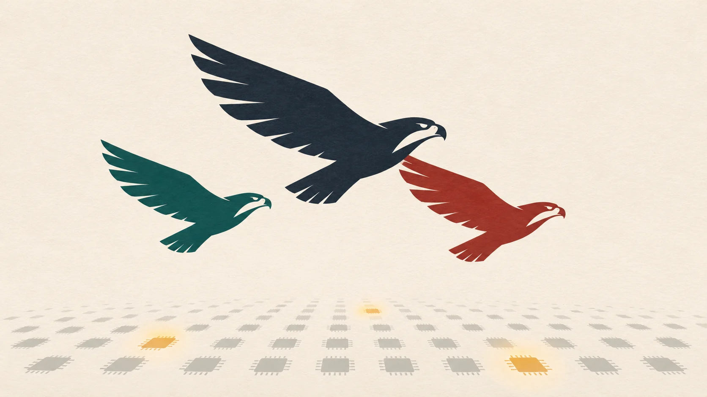
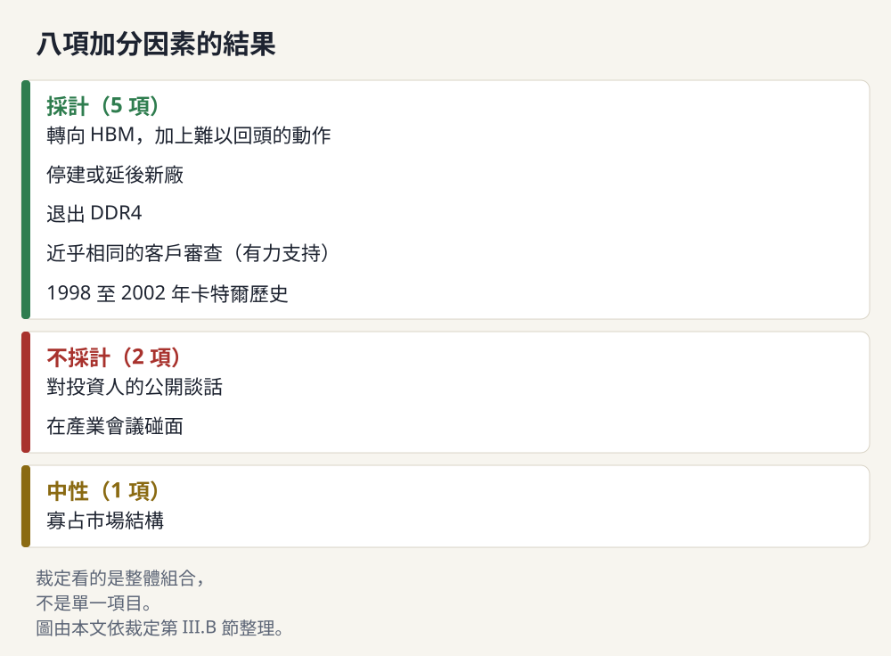
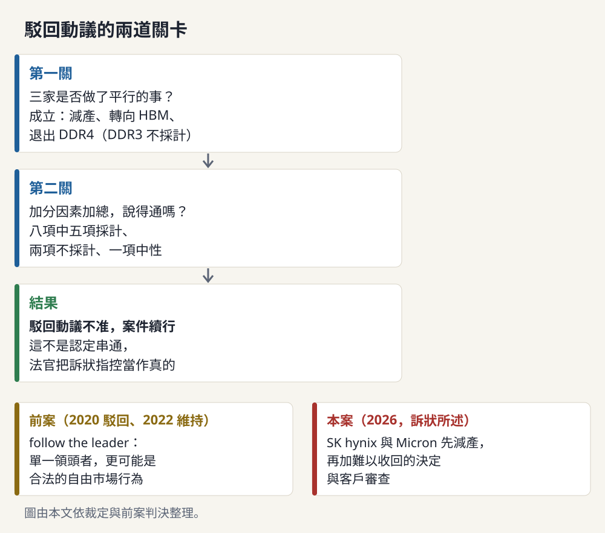
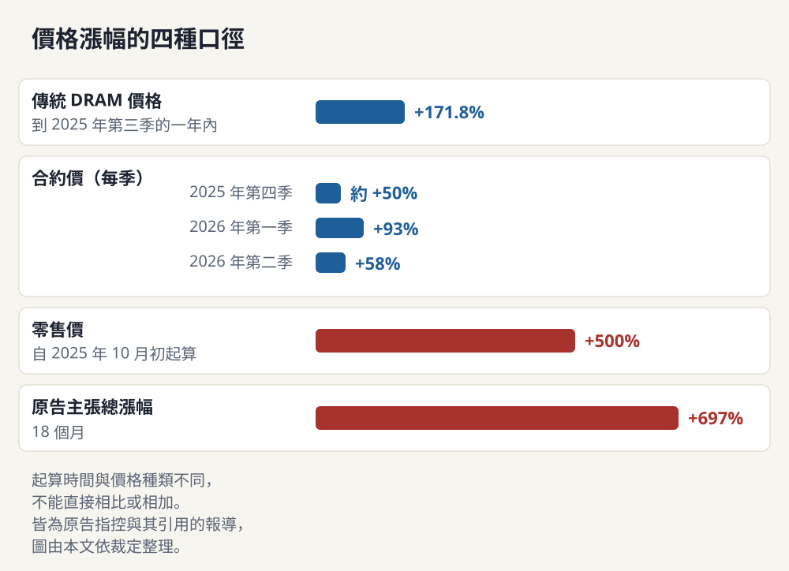

# 鷹群編隊：DRAM 價格操縱訴訟為何沒被駁回

> 本導讀的分析與撰稿由 AI 模型完成，不是人類分析，也沒有經過人工逐句校稿。

> 導讀的對象：Tom's Hardware 2026 年 11 月 15 日報導的 DRAM 價格操縱集體訴訟，以及承審法官 Noël Wise 2026 年 11 月 14 日的裁定原文。[Tom's Hardware 報導](https://www.tomshardware.com/tech-industry/big-tech/judge-denies-motion-to-dismiss-dram-price-fixing-lawsuit-against-micron-samsung-and-sk-hynix-says-chipmakers-acted-like-hawks-flying-in-formation-finds-evidence-of-dram-collusion-plausible-after-500-percent-price-surge)｜[裁定原文（20 頁 PDF）](https://litnews.ai/opinions/cand/5-26-cv-06345/ecf-68.pdf)

*圖：AI 製作的示意圖，三隻老鷹象徵三家記憶體廠，不是新聞照片。*

同樣是 Samsung、SK hynix、Micron 三家，同樣是北加州聯邦地方法院，同一條《休曼法》第 1 條。2020 年 11 月，一場指控三家限制記憶體供給的集體訴訟在這個法院被終局駁回（with prejudice，原告不得再補件重提），2022 年第九巡迴上訴法院維持原判。六年後的 2026 年 11 月 14 日，類似的指控換了一批原告，法官 Noël Wise 卻寫下：三家請求駁回起訴的動議，不准。

Tom's Hardware 的報導抓到了最好記的一句：法官說，原告描述的不只是老鷹互相盯著，更像是老鷹排成隊形一起飛。這句話底下有一整套判斷標準。裁定原文把八項「加分因素」（plus factors：光有「大家做了類似的事」還不夠，原告得另外拿出讓人懷疑事前有協議的情況）逐項過篩，五項算數，兩項不算，市場結構被擺在中性。

## 三十秒版

1. **這是駁回動議的裁定，不是判決。**法官把原告的指控當作真的來評估，結論只是這份訴狀的說法說得通，沒有認定三家串通。
2. **具名原告是 17 位消費者與小企業，來自五個州**（擬議的集體訴訟），指控三家自 2022 年 10 月起，在傳統 DRAM（不含 HBM，即 AI 加速器用的高頻寬記憶體）上維持一個限制供給的協議。
3. **法官採計了五項加分因素**（轉向 HBM 並鎖定 AI 供給、延後新廠、退出 DDR4、近乎相同的客戶審查、1998–2002 年價格操縱卡特爾的歷史），**兩項不採計、一項視為中性**（對投資人的談話與產業會議碰面不採計，寡占市場結構中性）。
4. **和 2018 年的前案相比，這次的差別在「誰先動」和「能不能回頭」**：前案法官形容為單一領頭者帶頭、其他人跟；這次原告描述的是 SK hynix 與 Micron 先減產，而且幾個動作難以逆轉。
5. **「一年漲 500%」要看口徑。**裁定裡的 500% 是零售價自 2025 年 10 月初起算；原告主張的總漲幅是 18 個月 697%。
6. **接下來**：三家要在 2026 年 12 月 7 日前答辯，初次案件管理會議訂在 2027 年 1 月 12 日。

## 裁了什麼，沒裁什麼

| 項目 | 內容 |
|---|---|
| 案名與案號 | Garciaguirre et al. v. Samsung Electronics Co., Ltd. et al.，N.D. Cal.，5:26-cv-06345-NW |
| 承審法官 | Noël Wise |
| 具名原告 | 17 位消費者與小企業，來自五個州（擬議集體訴訟）|
| 被告 | Samsung Electronics 與 Samsung Semiconductor、SK hynix、Micron Technology |
| 起訴日 | 2026 年 6 月 25 日 |
| 裁定日 | 2026 年 11 月 14 日（Tom's 報導在 11 月 15 日） |
| 主要主張 | 《休曼法》第 1 條（共謀限制貿易）；另有加州、佛羅里達、明尼蘇達、紐約、威斯康辛的州法主張 |

[裁定原文](https://litnews.ai/opinions/cand/5-26-cv-06345/ecf-68.pdf)的標題是「駁回被告的駁回動議（motion to dismiss），並准許延後初期案件期限」。駁回動議（motion to dismiss）的審查有一條基本規矩：法官要把原告寫在訴狀裡的具體事實當作真的（包裝成事實的法律結論除外），再問這些事實能不能合理推論出有協議（plausible，說得通），而不是問「是真的嗎」。所以**裁定裡凡是談到減產、客戶審查、不擴產的段落，講的都是原告的指控**。法官自己寫道，三家每一個決定「都有可能」是各自獨立做出的，即使是幾乎同時做的。

這一步的門檻放得很寬。裁定引第九巡迴的 SmileDirectClub 案：**原告不必提出能排除合法獨立行為可能性的事實**；再引前案 DRAM II：只需事實「大致上」與單方行動不符、與明示協調大致相符。但門檻也不是零：光有行為相似不夠，反壟斷案要求原告在平行行為之外再提出更多東西。

裁定另外描述了 DRAM 的銷售通路：大型系統廠（Dell、HP、Lenovo、Apple）、資料中心業者，以及把模組賣給小品牌、零售商或消費者的模組廠。Dell、HP、Lenovo、Apple 不在具名原告之列，裁定沒有談這件事。

## 老鷹的比喻從哪來

三家在庭上引用的是法官 Richard Posner 寫過的一句話：寡占市場裡的競爭者，彼此盯得像老鷹一樣。意思是，在只剩幾家的市場，大家看著對方的價格與產量做決定，本來就是常態。

[裁定原文](https://litnews.ai/opinions/cand/5-26-cv-06345/ecf-68.pdf#page=20)的回應是：

> 原告的指控超出了老鷹互相觀察；其主張更像是排成隊形飛行的老鷹，這是老鷹平常不會做的事。

（原文：Plaintiffs' allegations go beyond hawks watching each other; their contentions are more akin to hawks flying in formation – an activity that hawks ordinarily do not do.）

比喻背後是第九巡迴對加分因素的要求：要有這些因素，才能把平行行為放進一個暗示事前有協議的脈絡。法官的審查分三步：先確認平行行為（大家做了類似的事）成立，再逐項檢視加分因素，最後整體評估。

## 四個平行動作

<!-- FIG:dram-timeline -->

[裁定](https://litnews.ai/opinions/cand/5-26-cv-06345/ecf-68.pdf#page=4)把原告的指控整理成四條時間線，其中法官確認「至少三項」的平行行為成立。

| 時間 | 動作（均為原告指控） | 法官怎麼看 |
|---|---|---|
| 2022-10-26 起 | SK hynix 宣布減少資本支出與低毛利產品產量；Micron 在 2022-11-16 宣布減產；Samsung 在 2023-04-07 才宣布減產 | **成立**。前兩家相隔三週；Samsung 晚了約四個半月，時間上不那麼緊，但法官認為這樣的落差不至於否定平行行為 |
| 2023 年起 | 三家把產能與資本支出從傳統 DRAM 轉向 HBM | **成立**，但訴狀單寫「同時」只是結論，法官是靠訴狀的其他事實推定三家在 2023 年初到年中都開始轉向 |
| 2024–2025 | 退出老世代：Samsung 與 SK hynix 在 2024 年關掉 DDR3 產線；三家在 2025 年 4 至 6 月間都宣布逐步退出主流 DDR4 | **DDR4 成立，DDR3 不採計**，因為訴狀自己承認 Micron 仍有少量 DDR3 生產 |
| 2025 年第三季起 | 價格大漲之下，沒有一家擴產傳統 DRAM，或宣布要大幅擴產 | 不算獨立的「行為」，但被視為前面減產決定的另一面，放進加分因素裡評估 |

## 八項加分因素，各被怎麼對待

法官在[裁定的第 III.B 節](https://litnews.ai/opinions/cand/5-26-cv-06345/ecf-68.pdf#page=11)把原告提出的加分因素整理成八項（原告自己列了十一項，有些是同一件事的變形），逐項審酌。

*圖：法官對八項加分因素的處理（本文依裁定第 III.B 節整理）。*

| 加分因素 | 裁定 | 理由摘要 |
|---|---|---|
| 轉向 HBM、鎖定 AI 供給、拒簽 DRAM 長約、Micron 關閉 Crucial、不擴產傳統 DRAM | **採計（單獨不夠，加上相關動作才倒向原告）** | 單獨轉向 HBM 不夠，加上難以回頭的動作才過（見下文） |
| 停建或延後新廠（Samsung、Micron） | **採計** | 產能承諾不易逆轉，法官類比第九巡迴對煉油廠產能的見解 |
| 退出 DDR4 | **採計** | 三家在同一季內動作；DDR4 當時仍在廣泛使用，一度每 GB 比 DDR5 還貴 |
| 近乎相同的客戶審查（2026 年 1 月） | **採計，法官稱有力支持** | 法官評價最高的一項（見下文） |
| 對投資人的公開談話 | 不採計 | 與 2022 年第九巡迴判決處理過的陳述類似，未能區分 |
| 在產業會議碰面 | 不採計 | 未指出實際交換了什麼資訊 |
| 寡占市場結構 | 中性 | 三家合計超過九成市占，與前案結構相近 |
| 1998–2002 年價格操縱卡特爾的歷史 | **採計** | 第九巡迴在前案就認為這類歷史可以算，因為涉及同樣被指控的協調與行為人，本案法官照引（Samsung、Hynix 認罪受罰，Micron 參與但以污點證人獲豁免）|

**轉向 HBM 本身不算數。**法官同意被告的說法：依訴狀自己的指控，2023、2024 年轉向時 HBM 比 DRAM 賺錢。裁定接著說，投資新興市場本來有風險，但不是那種沒有事前協議就沒人敢做的險棋。真正讓這項加分因素過關的，是「回不去」的組合。據訴狀，三家都簽了鎖定 HBM 供給的多年期合約，Samsung 與 SK hynix 同時拒絕與主要 DRAM 客戶簽長約；Micron 在 2025 年 12 月 3 日宣布關閉 Crucial，那時消費端 DRAM 價格正在歷史高點；到訴狀提出時，三家沒有一家宣布要大幅擴產傳統 DRAM。法官寫道，這些動作屬於「在訴狀階段看來，沒有哪家理性的公司會在缺乏事前協議下這麼做」的那一類。

補一筆產業背景：裁定談到三家鎖定 AI 客戶的供給，但沒有提到 Micron 這批協議。Micron 在 2026 年 6 月 24 日的財報電話會議上說，已簽下 16 份多年期客戶協議，約占其至 2030 年 DRAM 出貨量的兩成，其中 14 份的最低合約金額合計約 1,000 億美元，預計收到約 220 億美元的現金訂金與相關財務承諾（[第三方轉錄逐字稿](https://transcripts.platformaeronaut.com/transcripts/MU-3Q26-transcript)與 [TrendForce 報導](https://www.trendforce.com/news/2026/06/25/news-decoding-microns-scas-reportedly-20-of-dram-output-toward-50-of-long-term-memory-revenue/)，皆為二手來源）。

**客戶審查是被法官評價最高的一項。**訴狀說，三家在 2026 年 1 月同時導入更嚴格的 DRAM 訂單審查，一位 GPU 與伺服器供應商的主管形容，三家都開始問他們賣給誰、數量多少、客戶需求是不是真的。法官同意原告的說法：同時採用幾乎相同的問題，「難以在沒有協調的情況下解釋」，也讓每家都能看見誰在買多少，類似 1998 至 2002 年那次卡特爾的監控機制。被告的反駁是 AI 需求太大、產能被吃光，所以才審查；法官指出時間對不上：AI 熱潮在 2023 年就開始，審查卻到 2026 年 1 月才出現，依原告主張，那時或稍早，傳統 DRAM 的獲利已超過 HBM。

**沒能加分的三項，也透露法官的標準。**對投資人談資本紀律，前案第九巡迴就認為不夠；這次 Micron 在 2022 年 9 月 29 日的說法（供給「依產業需求成長」、目標是「維持穩定的位元供給占比與供給紀律」），法官認為與前案相似，不採計。產業會議碰面，即使訴狀列出日期與出席主管，法官仍認為前案判決看來幾乎不留給它權重的空間，除非能指出實際交換了什麼資訊，或他們在會上達成協調供給的協議。寡占結構則如上表，與前案相近，放在中性。

## 為什麼這次過關，前案沒有

2018 年 4 月 27 日提起的前案（In re DRAM Indirect Purchaser Antitrust Litigation），集體期間是 2016 年 6 月 1 日至 2018 年 2 月 1 日；本案訴狀則稱 2016 年 8 月至 2018 年 8 月價格漲了 165%。2020 年 11 月，地院在給過一次修正機會後，以 with prejudice 終局駁回；2022 年 3 月 7 日第九巡迴維持原判，[判決原文](https://cdn.ca9.uscourts.gov/datastore/opinions/2022/03/07/21-15125.pdf)的說法是，被告在寡占產業裡的行為「更可能是合法、未經編排的自由市場行為」（more likely explained by lawful, unchoreographed free-market behavior）。

Wise 法官在裁定中把兩案的差別講得很具體。前案承審的 White 法官把案情形容為「follow the leader」：由市占最大的那家帶頭漲價或減產，其他家跟。裁定對這次指控的描述是另一幅畫面：**減產由 SK hynix 與 Micron 先動，不是單一領頭者帶頭**（原告引用 2025 年第三季市占：SK hynix 33.2%、Samsung 32.6%、Micron 25.7%）；訴狀說 Samsung 在 2023 年 1 月還公開表示不會有人為減產，到 4 月 7 日卻宣布減產；幾個決定一旦做下就難以甚至無法收回，包括多年期鎖單與關閉消費品牌；原告主張漲幅近 700%，至訴狀提出時仍沒有任何一家擴產或宣布大幅擴產傳統 DRAM（HBM 則持續擴產）；再加上同時出現的客戶審查，以及卡特爾的歷史。

*圖：法官判斷駁回動議的兩道關卡，與本案和前案的差別（本文依裁定與前案判決整理）。*

> 重點：法官是把各項合起來看的。單獨一項或許都能用合法理由解釋，但這次的組合在法官眼中，足以讓案子進入下一階段。

## 「漲 500%」是哪一個 500%

Tom's 報導的標題提到 500% 的漲價，內文寫價格「一年內最多漲 500%」。[裁定原文第 5–6 頁](https://litnews.ai/opinions/cand/5-26-cv-06345/ecf-68.pdf#page=5)的數字更細，而且口徑不同：

| 口徑 | 數字 | 出處 |
|---|---|---|
| 傳統 DRAM 價格，到 2025 年第三季的一年內 | +171.8% | 訴狀，裁定引用 |
| 合約價（非零售）| 2025 年第四季約 +50%、2026 年第一季 +93%、第二季 +58% | 訴狀引用的獨立報導 |
| 零售價 | 自 2025 年 10 月初起算 +500%（截至 2026 年 6 月 25 日起訴時）| 訴狀引用的獨立報導 |
| 原告主張的總漲幅 | 18 個月 +697% | 訴狀 |

*圖：四種價格口徑的漲幅（原告指控與其引用的報導，本文依裁定第 I.C 節整理）。*

500% 只對應零售價那一列；原告主張的約 700% 算的是 18 個月，不是一年。Tom's Hardware 自己追蹤零售 DDR5 套件最低標價，也有約 500% 的 12 個月漲幅（[二手報導轉引](https://hwbusters.com/news/ddr5-memory-prices-are-up-500-in-a-year-and-a-128gb-kit-now-lists-at-3399/)，標價不等於成交價）。所以**讀到「一年 500%」時，最好先問一句：是哪個價格，從哪個月算起**。

## 接下來會怎樣

[裁定](https://litnews.ai/opinions/cand/5-26-cv-06345/ecf-68.pdf#page=20)要求三家在 2026 年 12 月 7 日前提出答辯（answer）。三家在 2026 年 10 月 23 日申請延後初期期限，原告未提出異議，法院又因辯論期日重排了約三週而同步順延，把初次案件管理會議訂在 2027 年 1 月 12 日上午 9 點，Tom's 的「2027 年 1 月」就是這一天。

**這之後才進入檢驗這些指控是不是事實的階段**，包括證據開示（discovery）。

## 讀這則新聞時的限制

- 新聞面以 Tom's 一篇為主，另有二手報導確認有其他媒體報導；法律面依兩份法院文件；Micron 協議與零售價數字來自二手或第三方轉錄。Tom's 的標題與首段說法比裁定強，裁定只審指控是否說得通，沒有評估證據；「一年最多漲 500%」也未註明是零售價，本文以裁定為準。
- 本文寫「三家做了某事」時，指的都是原告的指控；法官在駁回動議的階段把這些指控當作真的來評估。
- 本文不判斷三家有沒有串通。

## 製作說明：這篇導讀由 AI 模型完成

本導讀的分析、撰稿、查證與審稿皆由 AI 模型完成，不是人類分析，也沒有經過人工逐句校稿。主控與撰稿為 Claude Sonnet 5.5；研究由兩個 Claude 子代理分別處理法院文件與記憶體產業事實；獨立審稿由兩位 Claude Opus 分別負責事實與編輯可讀性，修改後另有一位 Claude Opus 終審；最後再由 Claude Opus 依一份潤稿準則調整語句並標示重點，發布前另做一輪輕修，分享文同樣如此。重要說法須有法院文件等第一手來源才寫成確定事實，只有單方來源的內容降級標示。來源為英文，本文以台灣用語重述，沒有另做全文譯本。寫作參考了一則社群貼文的切角，其中的事實主張都另行查證，查無一手或可靠來源者不採用，也不複製貼文文字。封面是 AI 生成的示意插圖（Codex 生圖，不含文字與數據，不是新聞照片）；三張資訊圖由 Claude 依上文的裁定整理，以程式繪成向量圖，圖中數字都取自上文；時間線與表格由程式依文字資料產生。

## 來源清單

- [Garciaguirre et al. v. Samsung Electronics Co., Ltd. et al., No. 5:26-cv-06345-NW, Order Denying Motion to Dismiss; Granting Administrative Motion to Continue Early Case Deadlines（N.D. Cal., Doc. 68）](https://litnews.ai/opinions/cand/5-26-cv-06345/ecf-68.pdf)，2026-11-14（法院命令 PDF，第三方鏡像，未與法院網站比對）
- [Tom's Hardware：Judge denies motion to dismiss DRAM price-fixing lawsuit against Micron, Samsung, and SK hynix](https://www.tomshardware.com/tech-industry/big-tech/judge-denies-motion-to-dismiss-dram-price-fixing-lawsuit-against-micron-samsung-and-sk-hynix-says-chipmakers-acted-like-hawks-flying-in-formation-finds-evidence-of-dram-collusion-plausible-after-500-percent-price-surge)，Jowi Morales，2026-11-15
- [In re DRAM Indirect Purchaser Antitrust Litigation, No. 21-15125, 28 F.4th 42（9th Cir.）](https://cdn.ca9.uscourts.gov/datastore/opinions/2022/03/07/21-15125.pdf)，2022-03-07
- [PYMNTS／CPI：Samsung, SK Hynix and Micron Lose Bid to Dismiss US DRAM Antitrust Suit](https://www.pymnts.com/cpi-posts/samsung-sk-hynix-and-micron-lose-bid-to-dismiss-us-dram-antitrust-suit/)，2026-11-16（二手報導）
- [LitNews：Garciaguirre v. Samsung 案報導（含命令連結）](https://litnews.ai/articles/garciaguirre-samsung-sk-hynix-micron-dram-conspiracy-suit-survives-dismissal)（二手）
- [Micron FQ3 2026 財報電話會議逐字稿（第三方轉錄）](https://transcripts.platformaeronaut.com/transcripts/MU-3Q26-transcript)，2026-06-24（第三方轉錄，二手）
- [TrendForce：Decoding Micron's SCAs](https://www.trendforce.com/news/2026/06/25/news-decoding-microns-scas-reportedly-20-of-dram-output-toward-50-of-long-term-memory-revenue/)，2026-06-25（二手）
- [HWBusters：DDR5 memory prices are up 500% in a year](https://hwbusters.com/news/ddr5-memory-prices-are-up-500-in-a-year-and-a-128gb-kit-now-lists-at-3399/)，2026-08-18（二手；轉引 Tom's Hardware 零售標價追蹤）
